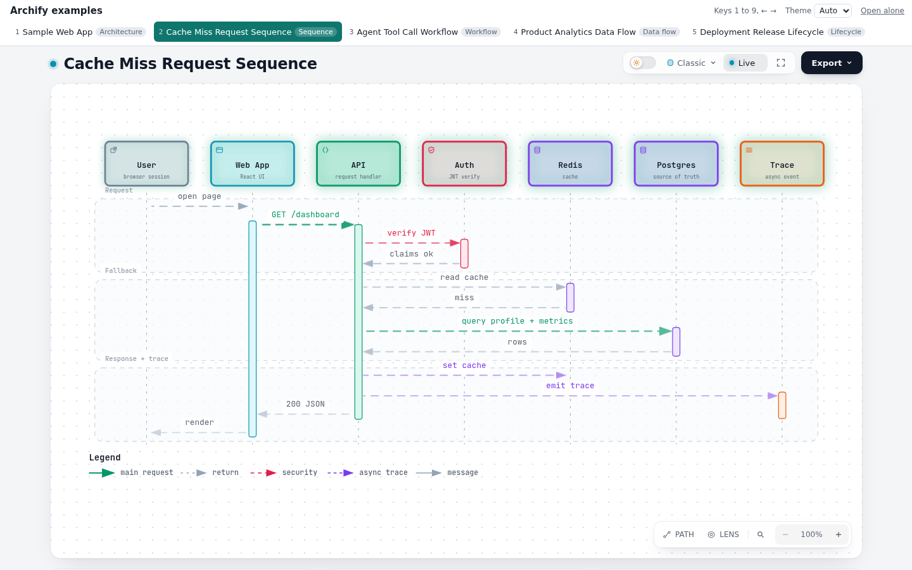

# archify-index

One page for a set of [Archify](https://github.com/tt-a1i/archify) diagrams. An independent tool,
not part of Archify.

Explaining one system often takes several diagrams: a map of the parts, a sequence or two, a
workflow. Archify writes each one as its own HTML page, so a reader ends up opening files one by
one. `archify-index` writes a single `index.html` beside them that shows the whole set in one
window: a tab per diagram, number and arrow keys to switch, and one theme for all of them.



**Live demo:** [thakay.github.io/archify-index](https://thakay.github.io/archify-index/), built
from Archify's own example specs, one per diagram type.

## Use it

You need Node.js 18.3 or newer. Point it at the pages Archify delivered, or at a folder that holds them:

```sh
npx github:Thakay/archify-index docs/diagrams/
```

That writes `docs/diagrams/index.html`. Open it in a browser; it works straight from disk. Run it
again after adding a diagram and it replaces the index it wrote before.

You can also hand it Archify JSON specs. It delivers each one with Archify first, into the index's
folder, then indexes the set:

```sh
npx github:Thakay/archify-index --archify ~/.claude/skills/archify/bin/archify.mjs \
  --title "Payments" -o site/index.html specs/*.json
```

`--archify` takes the `bin/archify.mjs` of an installed Archify skill (the path above is where
Claude Code keeps it) or of a checkout of Archify.
A spec Archify refuses stops the build, and its diagnostics are printed.

## What the page does

- **One tab per diagram,** titled with the diagram's own title and labelled with its type. The
  type comes from Archify's delivery receipt beside the page when it matches the page's bytes,
  else from the page's own description in English or Simplified Chinese. The tabs follow the
  usual tab pattern: arrow keys, Home and End.
- **Keys 1 to 9 and ← →** switch diagrams while the index has focus. The arrows wrap around.
- **Each diagram loads once.** The one you open loads first and the rest follow one by one, so
  later switches are instant and each diagram keeps its zoom and scroll.
- **The address follows the diagram,** such as `index.html#payment-flow`, so a link opens the
  right one. A click or a number key is a step for the browser's Back button; arrow keys are not,
  so Back does not replay every key press. Names in any script work, such as `#数据流`.
- **One theme for the set.** Auto, Light or Dark; the choice is passed to every diagram through
  Archify's own `?theme=` parameter, and remembered. A change reloads the shown diagram first and
  the rest one by one.
- **Open alone** opens the current diagram in its own tab.
- **Keyboard order matches what you see:** the theme, Open alone, then the tabs.
- **Without JavaScript,** the page is a plain list of links.

## Options

| Option | Default | Meaning |
|---|---|---|
| `-o, --out <file>` | `index.html` in the folder that holds every input; for specs alone, the current folder | The index to write |
| `--title <text>` | `Diagrams` (`图表` with `--lang zh-CN`) | The page's title |
| `--lang <en\|zh-CN>` | `en` | The language of the index's own words; diagram titles are never translated |
| `--embed` | off | Open diagrams without their toolbar (Archify's `?embed=1`) |
| `--archify <file>` | | Archify's `bin/archify.mjs`; needed for `.json` inputs |
| `--quality <level>` | `showcase` | `standard` or `showcase`, passed to `archify deliver` |
| `--json` | off | Print a machine-readable receipt instead of one line |

From code, after `npm install github:Thakay/archify-index`:

```js
import { buildIndex } from 'archify-index';

const receipt = await buildIndex({ inputs: ['docs/diagrams/'], title: 'Payments' });
// { ok: true, output, diagrams: [{ title, type, href, slug, archify }, ...] }
```

## What it promises

- **It never changes a diagram.** It reads each page as text, takes its title and type, and links
  to it. With `--archify`, Archify itself renders the specs. It replaces only an index it wrote
  before, and lets Archify replace only a page Archify wrote; anything else in the way is refused.
- **Only Archify pages.** A folder contributes the pages Archify wrote and skips the rest. A file
  you name that Archify did not write is refused.
- **One movable folder.** Every diagram must sit inside the index's folder, and links are
  relative, so the folder can be zipped, moved or published as it is.
- **Nothing leaves the page.** No fonts, scripts or requests from the network. Titles are escaped,
  so a title can never become markup. With `--archify`, Archify's own `deliver` step runs as it
  always does, including its update check.
- **Refusals are clear.** Errors name the file and what to do, exit with code 1, and carry a stable
  `code` in the `--json` receipt. Every input is checked before anything is written, so a refused
  run writes nothing. If Archify itself refuses a spec, the specs it delivered before that one stay
  in the index's folder, beside Archify's own recovery files, and no index is written.

| Code | Meaning |
|---|---|
| `no-inputs`, `missing-input`, `unknown-input` | Nothing named, a path that does not exist, or a file that is not `.html`, `.json` or a folder |
| `no-diagrams`, `not-archify`, `unreadable-input` | No Archify page among the inputs, a named page Archify did not write, a page that cannot be read |
| `outside-index-folder`, `no-common-folder` | A diagram outside the index's folder, or inputs that share no folder below the top of a drive |
| `would-overwrite`, `duplicate-name` | The index or a rendered spec would replace a file this tool or Archify did not write, or two outputs would share a name |
| `archify-required`, `archify-missing` | Specs without `--archify`, or an `--archify` path that is not a file |
| `unreadable-spec`, `invalid-diagram-type`, `render-failed` | A spec that is not JSON, a `diagram_type` Archify would never use, or Archify refusing to deliver |
| `unknown-language`, `unknown-quality`, `invalid-arguments` | An option value or argument the command does not take |
| `unexpected` | Anything else, with its stack trace; please report it |

## Limits

- Keys reach the index only while it has focus. Once you click inside a diagram, its own keys
  take over; click the top bar to use the index's keys again. Browsers do not let a page catch
  keys pressed inside a framed page from disk.
- Changing the theme reloads the diagrams, so each one returns to its starting view.
- It is built for desktop reading, as Archify is. On a phone the tabs scroll and the diagram fills
  the rest.
- Tested with Archify 3.0.1, on its five diagram types and spec versions 1 and 2. Archify's
  development line adds five more types and more Viewer languages. Their pages are labelled from
  the delivery receipt when it sits beside them, or from an English or Chinese description, and
  are otherwise shown without a type.

## Develop

```sh
npm ci
npm test                                         # unit tests; browser tests skip without Chrome
CHROME_PATH=/path/to/chrome ARCHIFY_BIN=/path/to/archify/bin/archify.mjs npm test   # everything
npm run demo -- /path/to/archify/bin/archify.mjs # builds the demo into site/
```

A skipped browser test is reported as skipped. CI runs the unit tests on Node 18, 20, 22 and 24,
and every test, with Chrome required, against Archify 3.0.1. The demo site is published only from
a commit whose CI passed.

## Credits

The example specs in `examples/specs/` are Archify's own, used under its MIT License; see
[their notice](examples/specs/NOTICE.md). This is an independent tool, not part of Archify.

## License

MIT
